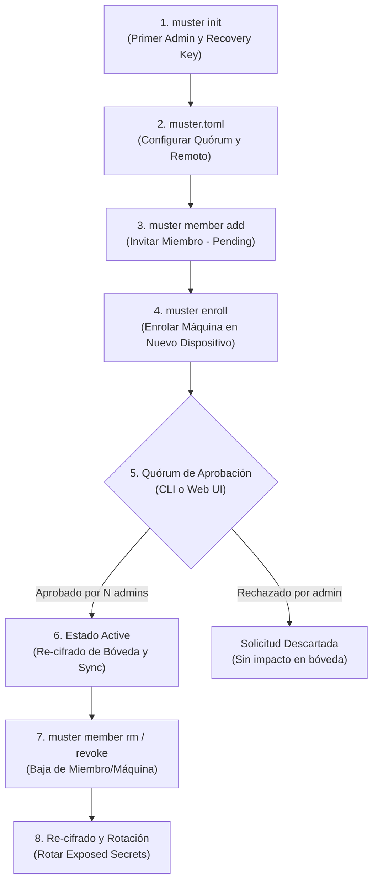

# Guía del Modo Equipo (Team Mode)

Esta guía explica en detalle cómo configurar, operar y gobernar Muster en entornos de equipo. Muster permite sincronizar la configuración de agentes de IA de código y credenciales compartidas utilizando un repositorio Git como único medio de transporte y coordinación, sin intermediación de servidores centralizados ni servicios de terceros.

---

## 1. ¿Qué es el Modo Equipo?

El **Modo Equipo** extiende las capacidades individuales de Muster para flotas compuestas por múltiples personas y dispositivos:

* **Repositorio Git Compartido:** Todo el estado canónico (manifiesto `muster.toml`, solicitudes de alta pendientes en `enroll/`, bóveda cifrada en `vault/`, perfiles y agentes) se versiona en un repositorio Git alojado en la infraestructura que elija el equipo (GitHub, GitLab, Gitea o un servidor SSH propio).
* **Almacén Distribuido y Cifrado con age:** Los secretos se dividen en **grupos de secretos** (`secret groups`). Cada grupo se almacena en el repositorio en formato cifrado con age (`vault/<grupo>.age`) junto a sus metadatos en texto plano (`vault/<grupo>.meta.json`), los cuales describen las claves almacenadas sin desvelar nunca sus valores.
* **Aislamiento Criptográfico Local:** Cada máquina enrolada posee su propio par de claves criptográficas age (`x25519`). La clave privada reside exclusivamente en el almacenamiento local del dispositivo (`~/.local/state/muster/identity.txt` en Linux o su ruta equivalente según XDG/macOS). **La clave privada nunca sale de la máquina**, ni se envía por Git ni se comparte con otros miembros.
* **Gobernanza con Quórum Multi-Administrador:** Las altas de nuevas máquinas y la aceptación de nuevos miembros en el equipo pueden requerir la aprobación de múltiples administradores (`[team] required_approvals = N`). Cada aprobación parcial se asienta con registro de auditoría y trailer de actor (`Muster-Actor: <admin>`) en el historial de Git.
* **Clave de Recuperación Fuera de Línea (*Recovery Key*):** Generada una única vez al inicializar el repositorio (`muster init`), es destinataria de todos los grupos del almacén y actúa como mecanismo de emergencia (*break-glass*) capaz de cumplir quórums de forma atómica en caso de inaccesibilidad de administradores.

---

## 2. Ciclo de Vida Paso a Paso

A continuación se detalla el flujo de trabajo completo desde la creación del repositorio hasta la baja de miembros y rotación de credenciales.



---

### Paso A: Inicialización del Repositorio de Equipo

El primer administrador inicializa el repositorio local de Muster en su máquina principal:

```sh
muster init --machine admin-laptop --yes
```

Este comando genera:
1. La identidad local de la máquina (`~/.local/state/muster/identity.txt`).
2. El manifiesto base `muster.toml`.
3. La **clave de recuperación fuera de línea (*recovery key*)**.

> [!IMPORTANT]
> Muster muestra la clave de recuperación **una sola vez** por pantalla. Cópiela y resguárdela en un gestor de contraseñas empresarial seguro o almacenamiento físico fuera de línea. Muster nunca almacena la clave privada de recuperación en disco.

#### Configurar el Quórum de Aprobaciones
Abra el archivo `muster.toml` y declare el umbral de quórum deseado en la sección `[team]`:

```toml
[team]
required_approvals = 2
```

* `required_approvals`: Número de administradores distintos necesarios para validar cualquier solicitud de enrolamiento de máquina o incorporación de miembro (entero $\ge 1$, por defecto `1`). Si se establece en `0`, Muster emitirá un error de configuración (`config_invalid`, código de salida 3).

#### Publicar en el Remoto Git
Conecte el repositorio local con el remoto de su organización:

```sh
git remote add origin git@github.com:mi-org/muster-config.git
git branch -M main
git push -u origin main
```

---

### Paso B: Invitación de un Nuevo Miembro

Para añadir un nuevo colaborador al equipo, un administrador emite la invitación:

```sh
muster member add alice --role member
```

* Roles disponibles:
  * `member`: Miembro estándar. Puede poseer máquinas asignadas y acceder a los grupos de secretos vinculados a su perfil o equipo. No puede aprobar solicitudes ni modificar membresías.
  * `admin`: Administrador. Puede invitar miembros, aprobar solicitudes, otorgar permisos y re-cifrar la bóveda.

**Materialización del Propietario Inicial:**
Al invocar `muster member add` por primera vez, el propietario original implícito del repositorio (`owner`) se materializa automáticamente en el manifiesto como un miembro administrador activo con su máquina asignada.

**Estado Pendiente:**
La invitación se registra en `muster.toml` con estado `pending`:

```toml
[members.alice]
role = "member"
status = "pending"
approvals = []
```

---

### Paso C: Enrolamiento de una Nueva Máquina

Cuando Alicia recibe el acceso al repositorio de Git en su equipo de trabajo, instala Muster y solicita el enrolamiento de su dispositivo:

```sh
# 1. Clonar el repositorio de configuración del equipo
git clone git@github.com:mi-org/muster-config.git ~/.config/muster

# 2. Generar identidad local y crear solicitud de enrolamiento
muster enroll --name alice-laptop

# 3. Enviar la solicitud al repositorio Git
git add enroll/alice-laptop.toml
git commit -m "chore(fleet): enroll request for alice-laptop"
git push origin main
```

El archivo `enroll/alice-laptop.toml` contiene la clave pública age (`recipient`), la plataforma, la versión de Muster y la lista de agentes de IA detectados localmente:

```toml
name = "alice-laptop"
recipient = "age1ql3z7hjy54pw3hyww5ayyfg7zqgvc7w3j2elw8zmrj2kg5sfn9aqmcac8p"
platform = "linux"
status = "pending"
approvals = []
```

---

### Paso D: Proceso de Aprobación con Quórum

Con `required_approvals = 2`, se requiere la validación de dos administradores independientes.

#### 1. Aprobación de la Invitación de Miembro (`alice`)
El Administrador 1 ejecuta:
```sh
muster member approve alice --yes
```
* Como se requiere 2 firmas, Muster añade el nombre del Administrador 1 a `approvals = ["admin1"]` y deja el estado en `pending`.
* El cambio se guarda y se sube a Git.

El Administrador 2 ejecuta la segunda aprobación:
```sh
muster member approve alice --yes
```
* Se alcanza el quórum ($2/2$).
* El estado del miembro pasa a `active`.

#### 2. Aprobación del Enrolamiento de la Máquina (`alice-laptop`)
El Administrador 1 asigna la máquina al miembro `alice` y otorga su aprobación:
```sh
muster approve alice-laptop --member alice --yes
```
El Administrador 2 valida y sella la incorporación:
```sh
muster approve alice-laptop --yes
```

#### ¿Qué ocurre al completarse el Quórum de Máquina?
1. La solicitud en `enroll/alice-laptop.toml` se elimina y se añade la máquina a `muster.toml` en `[machines.alice-laptop]`.
2. Se extrae la clave pública de `alice-laptop` y se incorpora como destinatario en los grupos de secretos a los que Alicia tiene acceso.
3. Se **re-cifran** los archivos `.age` correspondientes.
4. Una vez sincronizado el repositorio (`muster sync`), Alicia ya puede descifrar los secretos autorizados en su terminal.

> [!NOTE]
> **Vía de Emergencia (*Break-Glass*):** En situaciones críticas donde otros administradores no están disponibles, cualquier administrador puede usar la clave de recuperación fuera de línea. La clave de recuperación satisface el quórum de forma inmediata en una sola operación:
> ```sh
> cat recovery.key | muster approve alice-laptop --member alice --recovery-key-stdin --yes
> ```

---

### Paso E: Rechazo de Solicitudes

Si una solicitud de máquina o invitación de miembro no es autorizada o fue emitida por error, un administrador puede rechazarla.

#### Rechazar una Máquina Pendiente:
```sh
muster reject alice-laptop --yes
```
El comando de primer nivel `muster reject <máquina>` rechaza altas de máquinas pendientes. Para miembros, se usa el subcomando `muster member reject <miembro>`.

#### Rechazar un Miembro Pendiente:
```sh
muster member reject alice --yes
```

#### Comportamiento del Rechazo:
* Se elimina inmediatamente la solicitud (`enroll/<maquina>.toml` o `[members.<miembro>]`).
* **Se descartan todas las aprobaciones parciales acumuladas.**
* No se modifica la bóveda ni se revocan claves de miembros activos.
* Si en el futuro se desea admitir a la máquina o miembro, la solicitud deberá emitirse de nuevo y comenzará con 0 aprobaciones.

---

### Paso F: Baja de Miembros y Rotación de Secretos

Cuando un miembro abandona el equipo o se retira un equipo corporativo:

#### 1. Revocación del Miembro
```sh
muster member rm alice --yes
```

Muster realiza las siguientes acciones automáticamente:
1. Elimina al miembro `alice` del manifiesto.
2. Desvincula y revoca **todas** las máquinas asociadas a `alice`.
3. Retira las claves públicas de sus dispositivos de las listas de lectores de todos los grupos de secretos.
4. **Re-cifra de inmediato** todos los archivos `.age` afectados en el repositorio.

#### 2. Regla Crítica: Secretos Expuestos y Asesoría de Rotación
Al ejecutar `member rm` o `muster revoke <maquina>`, Muster imprime en consola el bloque de **Secretos Expuestos** (`exposed_secrets`):

```text
WARN: Member 'alice' removed.
Revoked machines:
  - alice-laptop
  - alice-desktop

Exposed secrets (had decrypt access in past generations):
  - native://engineering/openai_api_key
  - native://engineering/anthropic_api_key
  - native://backend/db_master_password

Rotation Advice:
  Re-encrypting the vault prevents revoked machines from decrypting FUTURE changes.
  However, secrets already downloaded by those devices must be rotated immediately
  at their respective service providers.
```

> [!CAUTION]
> **El re-cifrado criptográfico no borra secretos de discos ajenos.** Revocar una máquina solo impide que descifre el almacén a partir de este momento. Cualquier secreto que haya sido descifrado previamente por la máquina revocada debe considerarse potencialmente expuesto y debe ser **rotado de inmediato en el proveedor**.

Para actualizar el valor del secreto rotado en Muster:
```sh
muster secret rotate engineering/openai_api_key --value-stdin
```

---

## 3. Matriz de Equivalencias: CLI vs Web UI

Muster incluye una consola web local (`muster ui`) que expone todas las acciones de gestión de equipo con retroalimentación visual en tiempo real.

| Operación | Comando CLI | Equivalente en Web UI |
|---|---|---|
| **Ver estado y aprobaciones** | `muster status`<br/>`muster member list`<br/>`muster machine list` | Pestaña **Machines** (tabla pendientes) y pestaña **Members & groups** |
| **Contador de Quórum** | Salida JSON: `approvals_received` / `approvals_required` | Columna de estado en tablas: `${approvals.length}/${approvals_required} (admins)` |
| **Invitar miembro** | `muster member add <nombre> --role <rol>` | Formulario *"Add Member"* en pestaña **Members & groups** |
| **Aprobar miembro** | `muster member approve <nombre> --yes` | Botón **Approve** en la fila del miembro pendiente (`POST /api/member/approve`) |
| **Rechazar miembro** | `muster member reject <nombre> --yes` | Botón rojo **Reject** en la fila del miembro pendiente (`POST /api/member/reject`) |
| **Aprobar máquina** | `muster approve <maquina> --member <m> --yes` | Botón **Approve** en la tabla *Pending enrollment requests* (`POST /api/approve`) |
| **Rechazar máquina** | `muster reject <maquina> --yes` | Botón rojo **Reject** en la tabla *Pending enrollment requests* (`POST /api/reject`) |
| **Modificar rol** | `muster member role <nombre> --role <rol> --yes` | Selector de rol en la lista de miembros |
| **Baja de miembro** | `muster member rm <nombre> --yes` | Botón **Remove Member** en la fila del miembro activo |
| **Revocar máquina** | `muster revoke <maquina> --yes` | Botón **Revoke** en la lista de máquinas activas |

---

## 4. Buenas Prácticas y Reglas de Seguridad

### 1. Custodia de Claves Privadas
* Las claves privadas (`~/.local/state/muster/identity.txt`) residen con permisos `0600` en el dispositivo local.
* Nunca realice copias de seguridad de la carpeta de identidad local en el repositorio Git. Muster incluye patrones en `.gitignore` para prevenir inclusiones accidentales.

### 2. Regla contra la Auto-Concesión (*Self-Grant Prevention*)
Muster implementa protecciones estrictas a nivel de lógica de dominio:
* Ningún administrador puede aprobar su propia incorporación como miembro ni auto-otorgarse acceso a grupos de secretos adicionales en los que no figure.
* El intento de auto-aprobación o auto-asignación resulta en denegación de permisos (`security_error`, código de salida 5).

### 3. Idempotencia y Prevención de Voto Duplicado
* Un mismo administrador no puede emitir dos aprobaciones para la misma solicitud. Si lo intenta, el sistema responde con el error `already_approved_by_caller` (código de salida 5).

### 4. Gobernanza en el Repositorio Remoto Git
* **Protección de Ramas:** Se recomienda configurar reglas de protección en la rama principal (`main`) en GitHub/GitLab, exigiendo Pull Requests y revisión por pares para cambios manuales en `muster.toml`.
* **Auditoría de Commits:** Muster añade automáticamente un trailer a cada confirmación de Git indicando el autor de la operación:
  ```git
  chore(team): approval 1/2 for machine alice-laptop

  Muster-Actor: admin1
  ```
* **Separación de Grupos de Secretos:** No agregue a todos los miembros al grupo raíz. Fragmente las credenciales por dominio de responsabilidad (ej. `groups.backend`, `groups.frontend`, `groups.devops`).
